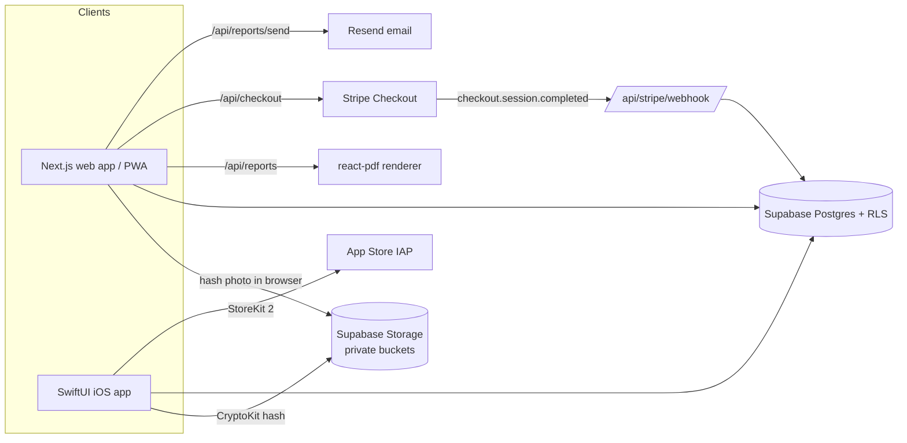

# Deposit Shield

Deposit Shield helps renters keep their security deposit. It records timestamped, SHA-256-fingerprinted move-in and move-out photos and turns them into a condition-report PDF and a small-claims evidence packet. It comes as a web app and a native iOS companion.

**Live:** [deposit-shield.vercel.app](https://deposit-shield.vercel.app)

## Why

California AB 2801 requires landlords to photograph units at move-in and move-out. Renters seldom keep records that good, so in a deposit dispute it's their word against the landlord's photos. Deposit Shield gives the renter the same kind of documentation: each photo is fingerprinted on the device when it's taken, and the result is a report formatted for a landlord, a mediator or a small-claims judge.

## Features

**Web app (renters)**
- Room-by-room move-in/move-out walkthrough with geolocation and capture time on every photo.
- On-device hashing: each photo is downscaled (~1600px, 80% JPEG) and SHA-256 fingerprinted in the browser with Web Crypto *before* upload, so the hash matches exactly what was captured.
- Side-by-side move-in vs move-out comparison per room.
- Condition-report PDF and evidence packet generated server-side with `@react-pdf/renderer` (no third-party PDF API).
- 50-state deposit-return deadline card and a demand-letter template (`src/lib/state-deposit-laws.ts`, `src/lib/demand-letter.ts`), labeled as general guidance, not legal advice.
- "Send to landlord": emails the PDF through Resend, or opens a prefilled `mailto:` draft with a signed download link when Resend isn't configured.
- Pricing: one free property with up to 10 photos and a watermarked preview, enforced by a database trigger. A **$17 one-time "Shield" unlock per property** through Stripe Checkout removes the photo cap and the watermark and unlocks landlord delivery and the evidence packet.
- Private storage only: photos and reports live in private buckets and are served through short-lived signed URLs.
- Installable PWA; account deletion endpoint.

**iOS app (`ios/`)**
- Fully native SwiftUI app (not a webview) against the same Supabase backend: native camera walkthrough with CryptoKit SHA-256, `UIGraphicsPDFRenderer` reports, deadline notifications, zoomable photo viewer.
- StoreKit 2 in-app purchase for the per-property unlock (`shield_unlock_17`), because App Store rules require IAP for digital unlocks; a `Configuration.storekit` file covers simulator testing.
- **Communities mode for self-managed HOAs:** associations with board/resident roles and join codes, violations with an escalation timeline and notice PDFs, a consistency ledger that shows enforcement was even-handed, recurring inspections, architectural (ARC) requests, announcements, and board motions with votes. Pro tier via StoreKit subscriptions; residents are always free.

## How it works



- Every integration is env-gated. With no environment variables set, `npm run build` still passes and the UI shows a "connect X" state wherever a missing key would block a feature. Without Stripe keys, paywalls show a labeled dev unlock so the paid flow stays testable locally.
- Row-level security keeps every table owner-only (or association-member-only for Communities). The free-tier limits are enforced in Postgres triggers, not only in the UI.
- Next.js 16 renamed middleware to `proxy.ts`; session refresh and the `/app` auth gate live in `src/proxy.ts`.

## Tech stack

Next.js 16 (App Router), React 19, TypeScript, Tailwind CSS v4, Supabase (Postgres, Auth via email magic link, Storage), Stripe Checkout, Resend, `@react-pdf/renderer`. iOS: SwiftUI, supabase-swift, StoreKit 2, CryptoKit.

## Getting started

### Web

```bash
npm install
cp .env.example .env.local   # every value is optional; see comments in the file
npm run dev
```

| Variable | Needed for |
| --- | --- |
| `NEXT_PUBLIC_SUPABASE_URL`, `NEXT_PUBLIC_SUPABASE_ANON_KEY` | Sign-in, properties, photos, reports |
| `SUPABASE_SECRET_KEY` | Account deletion and Stripe webhook writes (server only) |
| `STRIPE_SECRET_KEY`, `STRIPE_WEBHOOK_SECRET` | Real $17 checkout |
| `RESEND_API_KEY` | Emailing reports to landlords |
| `NEXT_PUBLIC_APP_URL` | Stripe redirect URLs and absolute links |

Supabase: create a project, run the migrations in `supabase/migrations/` in order (0001 tables + RLS, 0002 private `photos`/`reports` buckets and policies, 0003 free photo limit, 0004–0005 HOA Communities), then copy the URL and keys into `.env.local`.

Stripe: `stripe listen --forward-to localhost:3000/api/stripe/webhook` and put the printed secret in `STRIPE_WEBHOOK_SECRET`. In production, point a webhook at `/api/stripe/webhook` for `checkout.session.completed`.

### iOS

```bash
cp ios/DepositShield/Secrets.example.plist ios/DepositShield/Secrets.plist
# fill in SUPABASE_URL, SUPABASE_ANON_KEY and WEB_APP_URL
open ios/DepositShield.xcodeproj
```

Set your own development team and bundle identifier under Signing & Capabilities. The StoreKit configuration file lets you test purchases in the simulator without App Store Connect products.

## Project structure

```
src/
  app/            landing page, login, /app (properties, walkthrough, compare, report, evidence), API routes
  app/api/        checkout, stripe/webhook, reports (PDF), reports/send, account/delete
  lib/            env gating, Supabase clients, PDF templates, state deposit laws, demand letter
  components/     paywall sheet, FAQ, UI primitives
  proxy.ts        session refresh + auth gate (Next 16 middleware)
supabase/migrations/   schema, storage policies, free-tier trigger, HOA Communities
ios/              native SwiftUI companion app (renters + HOA Communities)
public/           PWA manifest and icons
```

## Status

The web app is live at [deposit-shield.vercel.app](https://deposit-shield.vercel.app). The iOS app builds but hasn't been submitted to the App Store; its in-app purchase products still need to be created in App Store Connect. HOA Communities exists only in the iOS app and its database migrations so far.

Built by [Ian Royes](https://github.com/ianroyes-sys)
